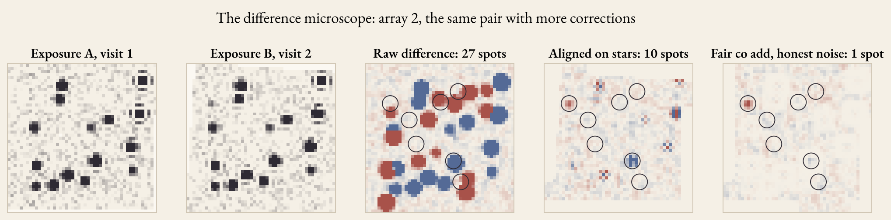
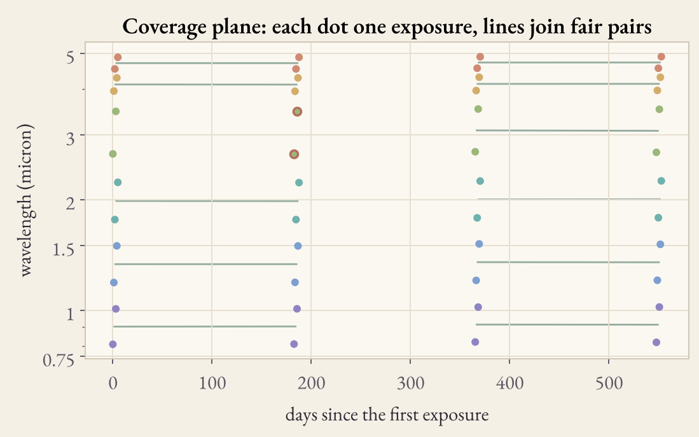
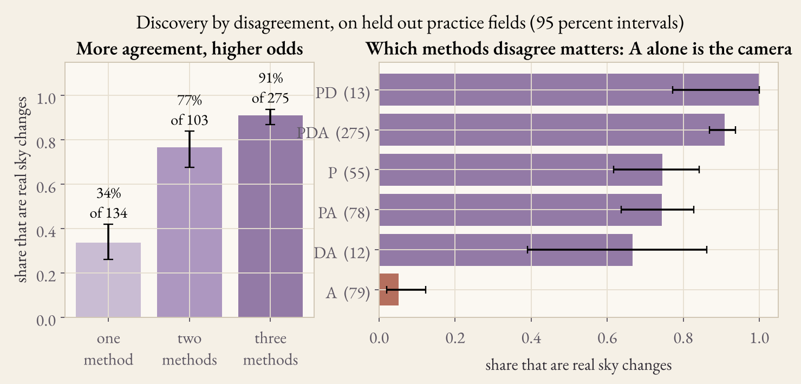
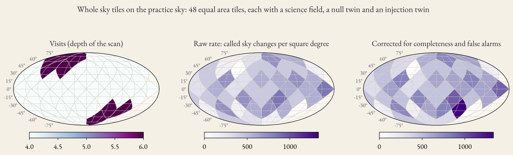
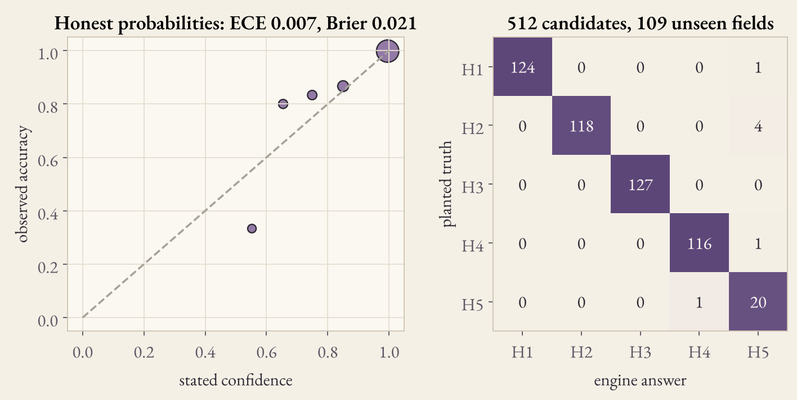
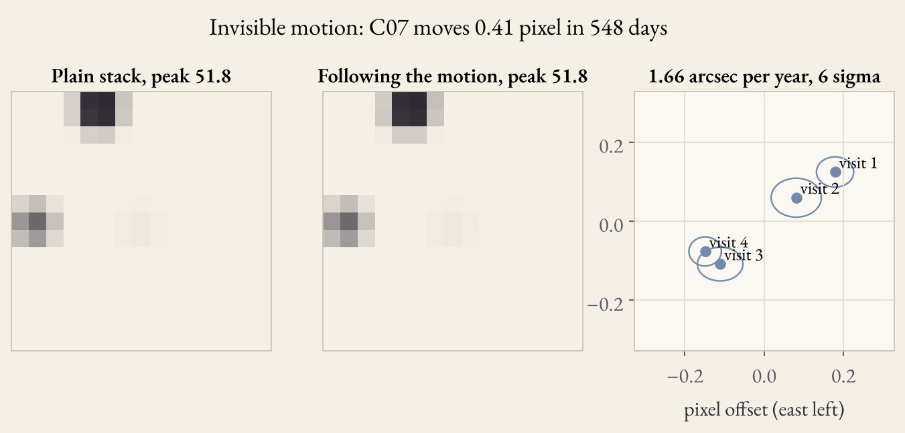

# Nakshatra CHRONOS

**An observatory for change in the SPHEREx infrared sky.** CHRONOS finds what changed between SPHEREx visits, tests whether the change is real, ranks five explanations, tries to prove its own answer wrong, and writes a report in which every sentence points to a measurement.

NASA Space Apps Challenge · Planet X and SPHEREx

* **Live observatory:** https://pritidipadas.github.io/nakshatra-chronus/
* **Demo video (30 seconds):** https://pritidipadas.github.io/nakshatra-chronus/media/chronos_demo.mp4 ([file](docs/media/chronos_demo.mp4))
* **Pitch deck (7 slides):** https://pritidipadas.github.io/nakshatra-chronus/deck.html ([PDF](docs/deck/CHRONOS_deck.pdf))
* **The story of one star, in English and Bangla:** https://pritidipadas.github.io/nakshatra-chronus/story.html
* **Submission text:** [docs/SUBMISSION.md](docs/SUBMISSION.md)



## CHRONOS 4D: ten laboratories (new)

**[Open the ten laboratories](https://pritidipadas.github.io/nakshatra-chronus/lab.html)** · [research laboratories](https://pritidipadas.github.io/nakshatra-chronus/chronos-lab.html) · details in [docs/CHRONOS_4D.md](docs/CHRONOS_4D.md)

CHRONOS does not merely search for changes. It investigates whether they are real, explains how they could have occurred, and names the evidence that would prove it wrong. Space × time × wavelength × evidence, for every candidate:

| Laboratory | What it does |
|---|---|
| 01 Sky and releases | Live searches default to DR1 + QR3 (`spherex_dr1+spherex_qr3`). QR2 is superseded and is never mixed with them without flux corrections. |
| 02 Spectral universe | A 102-channel spectral history F(λ, t), σ(λ, t): heatmap, time slider, difference view, uncertainty surface, feature explorer, detector comparison, stability score, a test of whether the wavelength sampling or the calibration explains the change, CSV export. DR1 blank channels 51 and 52 are shown, never filled. |
| 03 Instrument forensics | Ten tests (crosstalk, aurora, helium 1.083 µm, shuttle glow, dead pixels, nonlinearity, read noise, gain, zodiacal light, PSF), each naming the official calibration product that confirms it; a calibration impact experiment (319 raw spots → 4 sky candidates in the practice field). |
| 04 Case studies | 3I/ATLAS, SPLICES ice targets, RW Aurigae, brown dwarfs, R Draconis: adapters and the tests each case needs. |
| 05 Scientific court | Six separate confidences (detection, position, motion, brightness, spectral, interpretation), never one percentage. |
| 06 Planet X lab | The published IRAS–AKARI pair re-measured (47.46 arcmin in 23 years), motion sensitivity, survey selection, a falsification rule, the discovery ladder. |
| 07 Ice and molecules | Band depths of H₂O, CO₂, CO, CH₃OH, OCN⁻ ices with errors and named blends. |
| 08 Observation optimizer | Ranks the next measurement by expected information gain, says why, and gives approximate SPHEREx visibility windows. |
| 09 Validation observatory | Benjamini–Hochberg false-discovery control, chance expectation, negative controls, sensitivity, and real versus simulated: 29 of 120 real QR3 injections against 98.8 percent on the simulated sky. |
| 10 Human observatory | English–Bangla glossary, Cohen and Fleiss kappa for blind repeats. |
| 11 Evidence passport | Section-hashed, sealed record per candidate; verify with `sha256sum`, in the browser, or `scripts/verify_passport.py`. |

**Real data, run on GitHub Actions** (workflow `real data`, `scripts/real_data_run.py`, results in `data/real_data_run.json`): image counts per release at three places (for example 226 DR1 and 110 QR3 images at RW Aurigae); a real DR1 All-Sky Cube spectrum (tile Npix277, 102 × 512 × 512, BLANKCH D3:17 and D4:01, the missing channels 51 and 52); 12 SPLICES ice targets near RW Aurigae; the official DR1 helium, aurora, shuttle glow, nonfunctional pixel, spectral WCS, ePSF and crosstalk files; and 3I/ATLAS, with SPHEREx DR1 images at its JPL Horizons positions in August and December 2025.

Also added: the research extension pack (`backend/chronos_addons/`, 14 offline API routes; `research_discovery/`: DR1 and calibration discovery, native MEF download with checksums, ePSF stamps at sub-pixel phase, flag policy, detector-template reprojection, injection and recovery, Planet Nine population tools, citizen-study manifest and protocols) and two Kaggle notebooks for the real-data runs (`notebooks/kaggle/`). Physics first: no generative AI produces any result. 121 automated tests.

## The problem: you cannot blink SPHEREx

Pluto was found by blinking two photographic plates. SPHEREx cannot be blinked. A linear variable filter sits in front of each of its six arrays, so every pixel of every exposure sees its own color of infrared light, from 0.75 to 5 micron in 102 channels. Two pictures of one star differ when the color differs, even when nothing in the sky changed. A naive difference image of two SPHEREx exposures is full of false change.

CHRONOS compares only **fair pairs**: the same array, nearly the same color, one data release. Then it asks five questions of every change:

1. **What changed?** Three independent methods look.
2. **Where?** On one grid, anchored to Gaia stars, with measured position errors.
3. **Is it real?** The artefact court, the simultaneous array behind the dichroic, the flags, crosstalk geometry, counterfactual reanalysis.
4. **What is it?** Five hypotheses with calibrated probabilities, and the right to say unknown.
5. **What would prove us wrong?** The self questioning machine runs the tests that could break the leading explanation.



## Discovery by disagreement

Three methods read the same pixels in different ways:

| Method | What it does | Its typical failure |
|---|---|---|
| **P** catalog | Matched filter detection in each visit, PSF centroids, links across visits, motion court, brightness and presence tests with measured floors | Changes between visits that have no fair color match |
| **D** difference | Fair co adds of two visits, Z = (I2 − k I1) / √(σ1² + k² σ2² + (f s)²), with the resampling error f measured on catalog stars, summed over arrays | Slow changes; it cannot see across a color gap |
| **A** anomaly | Eight time features per pixel against fair partners, ranked by an isolation forest, a local outlier factor and a robust covariance model | Bright single exposure events that are not in the sky |

CHRONOS keeps the agreement pattern of every candidate and treats it as a measurement. On 109 simulated fields that the engine never saw, a candidate flagged by one method is a real sky change in 34 percent of cases, by two methods in 77 percent, and by all three in 91 percent. A candidate seen **only** by the anomaly ensemble is a real sky change in 5 percent of 79 cases: almost always the camera. And agreement is not proof: in the simulated field a crosstalk copy of a bright star fooled all three methods, and the instrument tests caught it.



## What the observatory shows

| Chapter | What you can do |
|---|---|
| I Sky and time | Every exposure on one grid. Time slider, blink, six arrays or white light, deep co add, anomaly, coverage, depth and position error maps, Gaia and AllWISE overlays, zoom, pixel reading with RA and Dec, a space and time slice, and the temporal cube I(α, δ, t) |
| II Fair pairs | The coverage plane of color against time, fair pairs drawn, and the calibration guardian of releases and star gains |
| III Difference microscope | One pair, six layers of correction, and the count of spots that survive each layer |
| IV Candidates | Methods P, D, A, the five hypothesis bars, verdict, robustness, a population map with coverage |
| V Dossier | Visit cutouts and a stack that follows the motion, the memory of the place, hypotheses with adjustable priors, the disagreement, the oracle, the self questioning tests, the artefact court, the counterfactual profile, the debate of three analysts, track, light curve, spectral fingerprint F(λ, t), temporal fingerprint, identity network, a cross match with Rubin alerts and known small bodies (live mode), and the report with evidence references |
| VI Motion map | Every track, larger than life, with error ellipses |
| VII Validation | Calibration, confusion, completeness, adversarial artefacts, empty fields, static stars, time shuffle, alignment stress |
| VIII Open questions | Testable suggestions with a falsification rule, never findings |
| IX Planet X lab | A sandbox for a hypothetical planet and the ladder from prediction to discovery |
| X Citizen lab | The citizen study (instructions, practice cases with feedback, a fixed case order, blind repeats, confidence, export) and quick blind judgements with a human and machine disagreement archive |
| XI Black box | SHA 256 seal of inputs, thresholds, versions and outputs, a reproduce button, a package download, and publishing of the package to a Hugging Face dataset |
| XII Whole sky | 48 equal area tiles: a change map corrected for coverage, with a null twin and an injection twin per tile |

Ask the sky in plain words: "show moving candidates", "brightness changed more than 20 percent", "explain C03", "evidence against C01", "compare visit 1 and 2", "poor quality exposures", "269.45 4.74". The parser maps each question to a measurement and shows the structured query. It never invents an answer. Positions and fields go into the address bar, so a link reopens the same view.

## Results on the simulated sky

The simulated sky follows the SPHEREx rules (six arrays, colors that step through each band, surveys 3 and 4 half a channel away, two arrays behind the dichroic at the same moment, noise that the VARIANCE plane understates in the long arrays) and hides a known truth: movers, variables, flares, appearing and vanishing sources, glitches, hot pixels, crosstalk ghosts, flagged blobs and a calibration step between releases.

| Measure | Value |
|---|---|
| Training | 251 fields, 1145 candidates |
| Test | 109 unseen fields, 512 candidates |
| Engine accuracy when it decides | 98.8 percent (unknown for 1.8 percent) |
| Calibration | Brier 0.021, expected calibration error 0.007 |
| Camera effects rejected (called artefact or unknown) | glitch 36 of 36, hot pixel 34 of 34, crosstalk 47 of 47 |
| Empty fields | 0.375 false candidates per field (40 fields) |
| Catalog stars with no motion called moving | 0 of 840 (95 percent interval 0 to 0.5 percent) |
| Moving sources found at AB 15, 17, 18 | 97, 89, 45 percent |

These numbers hold for the simulated sky only. Real SPHEREx data will be harder. The live path now runs on real QR3 files: search, cutouts, the color of each pixel, the QR3 EPSF table and Gaia anchors all work (see On real SPHEREx data below and [docs/LIMITS.md](docs/LIMITS.md)).

### On real SPHEREx data

The injection tool ran on real QR3 files from NASA IRSA, on GitHub Actions (workflow real_injection). It planted 120 known movers, variables and transients into five real fields: R Draconis and four deep fields near the ecliptic poles, where QR3 holds visits over about two months. Results (data/real_injection.json):

| Measure | Real QR3 | Simulated sky |
|---|---|---|
| Planted sources found | 29 of 120, 24 percent (17 to 33) | 97 percent of movers at AB 15 |
| Found by brightness, AB 14, 15, 16, 17, 18 | 13 of 28, 6 of 22, 6 of 31, 4 of 26, 0 of 13 | |
| Engine trained on simulated fields | unknown for all 29: it saw that real data is unlike its training | 98.8 percent right when it decides |
| Engine retrained with the real rows (each field held out) | decides 17 of 29, right in 12 (71 percent, 47 to 87) | |
| New false candidates caused by planting | 0.5 per trial in one field, 0 in the others | |

Real data is much harder than the simulated sky. QR3 covers about two months of each place, so slow movers and slow variables barely change; two deep fields have only arrays 2 and 5; R Draconis is a saturated Mira and no planted source was recovered near it. At low ecliptic latitude (Barnard's Star, RW Aurigae, Epsilon Indi B) QR3 holds one visit, so no change can be seen there yet, and the QR2 search returned no files at these places. The important result: the engine refused to classify real candidates instead of making false claims. The retrained engine is kept apart in data/engine_real.json; the app still uses the simulated engine.

### Whole sky tiles

48 equal area tiles, each with a science field, a null twin and an injection twin. The engine was trained on four visit fields, so in the deep six visit tiles near the ecliptic poles it says unknown more often: the raw count finds only 45 to 50 percent of the planted changes there, against 97 percent elsewhere. Without a correction, the map of changes would be a map of the survey. Dividing by the completeness of each kind of tile (from the injection twins, never from the truth of the science field) and removing the false alarms of the null twins brings the deep tiles to 91 and 117 percent and the whole sky to 106 percent of the truth. Every tile agrees with its truth within two errors.






## Run it

The live observatory needs nothing. It shows the seven simulated fields and replays the bilingual story from answers recorded in the full app. For the full app (any coordinate, any field of view, live SPHEREx data, the reproduce button, the story with any star):

```bash
pip install -r requirements.txt
python run.py                      # then open http://127.0.0.1:8000
python -m pytest tests research_discovery/tests -q   # 121 tests
python scripts/build_lab.py        # CHRONOS 4D laboratories into site/data/lab
python scripts/calibrate_engine.py # retrain and rescore the engine (about 15 minutes)
python scripts/build_static.py     # rebuild site/ for GitHub Pages
python scripts/record_story.py     # record the story answers for the hosted page
python scripts/build_deck.py       # rebuild the 7 slides and the PDF
python scripts/make_figures.py     # rebuild docs/figures
python scripts/make_sky_tiles.py   # whole sky tiles (about six minutes)
python scripts/inject_real.py --retrain   # plant sources in real QR3 exposures, score and retrain (needs IRSA access;
                                   # or run the workflow real_injection from the Actions tab)
python scripts/analyse_citizen_study.py answers/*.json   # pool citizen study answers
docker build -t chronos . && docker run -p 8000:8000 chronos
```

## Repository map

```
backend/     FastAPI app and the science: core.py, pipeline.py (three detectors), investigate.py (reasoning),
             engine.py (five hypotheses), sky.py (simulated sky), connectors.py (IRSA, Gaia, AllWISE, JPL, Rubin
             alerts, Hugging Face), inject.py (planting in real exposures), study.py (citizen study),
             observatory.py and extras.py (endpoints)
frontend/    the observatory page (index.html, app.js, next.js, charts.js, style.css), the story page, fonts, architecture.svg
data/        engine.json (frozen model), validation.json (all scores), sky_tiles.json, study.json; see data/README.md
notebooks/   four notebooks with outputs: fair pairs, disagreement, validation, live archive walkthrough
scripts/     calibration, static build, figures, deck and video builders
tests/       73 tests, including the live path and the real data injection offline with files in the IRSA layout
docs/        architecture, methods, validation, data, limits, submission text, deck, video, figures
site/        the static observatory, built by scripts/build_static.py and served by GitHub Pages
```

Architecture: [docs/ARCHITECTURE.md](docs/ARCHITECTURE.md) · Methods: [docs/METHODS.md](docs/METHODS.md) · Validation: [docs/VALIDATION.md](docs/VALIDATION.md) · Data: [docs/DATA.md](docs/DATA.md) · Sources: [docs/CITATIONS.md](docs/CITATIONS.md)

## Data used

* **SPHEREx Quick Release spectral images (QR2 and QR3), NASA IRSA.** Found with the IRSA SIA2 service, read as cutouts. CHRONOS uses every extension: IMAGE for the sky, FLAGS for masks and contamination counts, VARIANCE for the noise model (checked on empty sky), ZODI for the background level, PSF for photometry, WCS-WAVE for the color of each pixel, and the alternate WCS A for detector positions.
* **Gaia DR3, ESA.** Star anchors, star ensemble gains, catalog motion for cross matching.
* **AllWISE, NASA IRSA.** Overlay in live mode.
* **JPL Small Body Identification service.** Known small bodies in live mode.
* **Rubin LSST alerts through the ALeRCE broker.** Cross match in the dossier, live mode. NEO Surveyor joins when its data is public (launch planned no earlier than September 2027).
* **Hugging Face Hub (optional).** Publishing of sealed packages to a dataset repository.

## Honesty

CHRONOS uses candidate language only. Nothing here is a discovery. NASA states that Planet X (Planet Nine) has not been discovered and that its existence is debated; the Planet X lab teaches the difference between a prediction, a candidate, a statistically supported detection and a confirmed discovery. IRSA already offers a Moving Object Search Tool and a spectrophotometry tool; CHRONOS does not replace them. To my knowledge, the fair pair rule, the use of disagreement between three detectors as a calibrated signal, and the self questioning tests are new in this combination for SPHEREx.

## Use of Super Intelligence (SI) tools                                                                                                                  

No  Assistance from AI in any ways.No image, video or audio in the project is SI-generated: every figure is drawn by the project code from simulated data or NASA archive data. No NASA logo or branding is generated or modified. No scientific result is produced by a language model.

## Cite and license

Citation metadata: [CITATION.cff](CITATION.cff). Code: Apache License 2.0 ([LICENSE](LICENSE)). Font: EB Garamond, SIL Open Font License ([frontend/fonts/OFL.txt](frontend/fonts/OFL.txt)).
