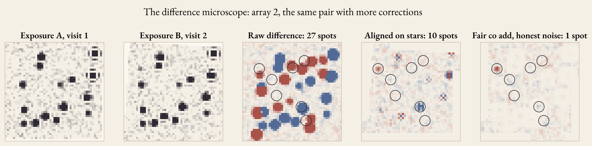

# Nakshatra CHRONOS

**Pluto was found by blinking two photographs. SPHEREx cannot be blinked.** Every pixel of NASA's SPHEREx telescope sees its own colour of infrared light, so a star that never changed still looks brighter or fainter when it lands on another pixel. CHRONOS is the physics and the software that decide whether a change is in the sky, or only in the colour, the camera or the calibration.

By Pritidipa Das. Physics and astronomy.

* **Project site:** https://pritidipadas.github.io/nakshatra-chronus/
* **The observatory:** https://pritidipadas.github.io/nakshatra-chronus/observatory.html
* **Demo video (30 seconds):** https://pritidipadas.github.io/nakshatra-chronus/media/chronos_demo.mp4
* **Slides:** https://pritidipadas.github.io/nakshatra-chronus/deck.html
* **The story of one star, in English and Bangla:** https://pritidipadas.github.io/nakshatra-chronus/story.html
* **Real-data runs:** [GitHub Actions](https://github.com/PRITIDIPADAS/nakshatra-chronus/actions)



## The problem

A linear variable filter sits on each of the six SPHEREx arrays. Its colour runs from one edge to the other, 0.75 to 5 µm over 102 channels, with resolving power R = λ/Δλ between 35 and 130. Because R is constant across a band, the wavelength a pixel sees grows geometrically with its column:

λ(x) = λ_min (λ_max / λ_min)^(x/N),  Δλ = λ / R

Two pictures of one star taken on different visits usually put it on different columns, so they measure two different colours. For a Sun-like star at 1.6 µm, one channel of offset fakes a change of about 5 percent. On the edge of a 3.05 µm water-ice band it can fake more than 20 percent (computed in `matlab/export_lvf_curves.m`). A naive difference image of two SPHEREx exposures is full of changes that never happened. In the practice pair above, 27 spots survive a raw difference, 10 survive alignment on stars, and 1 survives a fair co-add with honest noise.

SPHEREx will measure more than 100 million stars in the Milky Way, each in all 102 channels at least four times, and the data are public within weeks. Anyone who wants to say a star changed needs a way to rule out the instrument first.

## What CHRONOS does

It compares only **fair pairs**: the same array, colours within half a channel, one data release. Then it asks five questions of every change:

1. **What changed?** Three detectors read the same pixels: P, a catalogue of each visit; D, fair-pair differences; A, an anomaly ensemble.
2. **Where?** One grid anchored to Gaia stars, with measured position errors and the SPHEREx spectral WCS for the colour of each pixel.
3. **Is it real?** An artefact court: flags, crosstalk geometry, the twin array behind the dichroic, counterfactual reanalysis.
4. **What is it?** Five hypotheses (moving, variable, transient, artefact, nothing) with calibrated probabilities and the right to say unknown.
5. **What would prove it wrong?** The leading explanation is attacked with the tests most likely to break it.

### The physics in the code

| Piece | Equation | Where |
|---|---|---|
| Fair pair | same array, \|λ₁ − λ₂\| ≤ ½ Δλ, same release | `backend/core.py` `pair_score`, `matlab/fair_pair.m` |
| Honest difference | Z = (I₂ − k I₁) / √(σ₂² + k²σ₁² + (f s)²), f measured on unchanged stars | `backend/core.py` `zmap`, `matlab/diff_z.m` |
| Motion court | fixed, linear motion, motion plus parallax; BIC = χ²/s² + k ln(2n); motion needs ΔBIC > 10 | `backend/core.py` `motion_fit`, `matlab/motion_court.m` |
| Parallax | Δα* = ϖ (X sin α − Y cos α), Δδ = ϖ (X cos α sin δ + Y sin α sin δ − Z cos δ) | `backend/core.py` `plx_factors` |
| Known asteroids | observer at SPHEREx's own position from JPL Horizons (id −163182) | `backend/connectors.py` `known_movers` |
| Calibrated injection | F[Jy] → surface brightness through each pixel's solid angle; source Poisson noise from the absolute gain map | `research_discovery/validation/injection_recovery.py` |
| Intervals | Wilson score interval | `backend/core.py` `wilson`, `matlab/wilson.m` |

The MATLAB files are an independent re-implementation. `tests/test_matlab_crosscheck.py` runs them in GNU Octave and requires the same answers as Python, to 10⁻¹² for the difference statistic and the intervals.

## Results on a practice sky with a hidden truth

The simulated sky follows the SPHEREx rules (six arrays, colours that step through each band, two arrays behind the dichroic at the same moment, noise the variance plane understates) and hides movers, variables, flares, glitches, hot pixels, crosstalk copies and a calibration step between releases. The engine trains on some fields and is scored on fields it never saw.

| Measure | Value |
|---|---|
| Test set | 109 unseen fields, 517 candidates; three in ten fields are deep six-visit fields |
| Right when it decides | 98.4 percent (unknown for 1.2 percent) |
| Calibration | Brier 0.028, expected calibration error 0.003 |
| Camera effects called a sky change | 0 of 118 (37 glitches, 34 hot pixels, 47 crosstalk copies) |
| Real sky change, by detectors agreeing | one 29 percent, two 75 percent, three 90 percent; anomaly ensemble alone 8 percent |
| Empty fields | 0.45 false candidates per field (40 fields) |
| Unmoving catalogue stars called moving | 4 of 5,599 (0.07 percent) |
| Moving sources found at AB 15, 17, 18 | 95, 95, 45 percent |
| Whole sky, 48 tiles, after the coverage correction | 105 percent of the true change rate; every tile within two errors; deep tiles 94 percent complete (46 percent before retraining) |

These hold for the practice sky only.

## Results on the real SPHEREx sky

Everything here ran on GitHub Actions against NASA IRSA. Native files are checked against archive checksums and the hashes are kept.

**Seven calibrated DR1 fields.** One native 2040 × 2040 D2 exposure per field, with its spectral WCS, absolute gain and pixel solid angle maps linked through the archive's own provenance records. Twenty sources planted at each of half, one and two times the field's local 5σ limit, each with its own photon noise:

| Field | Local 5σ (µJy) | Recovered at ½, 1, 2 × 5σ |
|---|---:|---|
| M101 | 108.4 | 5, 14, 17 of 20 |
| High latitude control | 114.1 | 6, 13, 17 |
| Perseus / NGC 1333 | 161.6 | 3, 5, 12 |
| Orion A | 159.3 | 3, 5, 11 |
| Rho Ophiuchi | 205.0 | 2, 4, 9 |
| Taurus / Auriga | 178.4 | 3, 3, 8 |
| Lupus III | 211.2 | 0, 0, 0 |

Quiet fields behave as the noise predicts. Crowded star-forming clouds are harder, and Lupus III recovered nothing, even at twice its limit.

**Why Lupus III gave zero.** A new diagnostic (`research_discovery/spherex/summarize_injection_diagnostics.py`, run 45787598732) records why each planted source was missed. In Lupus III all 60 misses are the same kind: the source made a peak, but a brighter neighbour won. On their own the planted sources were bright enough (20 of 20 at twice the limit). The cause is the sky: in the injection region the pixel scatter is 5.5 times what the pipeline variance predicts, against 1.2 in the quiet control, because nebular emission in the cloud is structured on the scale of the PSF. Across the six fields, recovery falls as this excess rises (control 1.2, Taurus 1.3, Perseus 2.0, Orion 2.3, Rho Ophiuchi 3.4, Lupus III 5.5).

A secondary variant models that structured sky (a 32-pixel mesh background and an empirical noise scale) and plants sources at the 5σ limit this honest noise implies. For Lupus III that limit is 3.1 times brighter, and 7 and 5 of 20 are then found at one and two times it, instead of 0. In the quiet control the variant is stricter than the primary rule (0, 4, 17 of 20), so at first it was reported only beside the primary rule. Data: [data/injection_diagnostics.json](data/injection_diagnostics.json). Earlier investigation: [docs/SPHEREX_LUPUS_III_ZERO_RECOVERY_INVESTIGATION_2026-11-25.md](docs/SPHEREX_LUPUS_III_ZERO_RECOVERY_INVESTIGATION_2026-11-25.md).

**A preregistered test on six new fields.** Before any of them was downloaded, four predictions and a decision rule were committed in [docs/PREREGISTRATION_SKY_AWARE_NOISE_2026-11-26.md](docs/PREREGISTRATION_SKY_AWARE_NOISE_2026-11-26.md). Five fields completed (run 45835103107); Corona Australis stopped after 10 of 25 field checks and does not count.

| Field | Noise excess | Primary rule | Sky-aware rule |
|---|---|---|---|
| High-latitude control (south) | 1.18 | 15 of 20 | 18 of 20 |
| IC 348 | 1.36 | 14 of 20 | 14 of 20 |
| NGC 2264 | 2.30 | 0 of 20 | 3 of 20 |
| Chamaeleon I | 3.32 | 12 of 20 | 17 of 20 |
| Serpens Main | 7.95 | 1 of 20 | 15 of 20 |

All four predictions held (ρ = −0.70 for recovery against noise excess, ρ = 1.00 for the limit ratio). By the rule written in advance, the sky-aware rule is now the reported rule where the noise excess is 2 or more, with the primary rule beside it. Each rule is counted at twice its own limit, so this shows an honest limit, not extra sensitivity. Scored by `scripts/evaluate_holdout.py`; result in [data/holdout_result.json](data/holdout_result.json).

**QR3 planting.** 120 movers, variables and transients planted in five real QR3 fields: 29 found (24 percent; by magnitude AB 14 to 18: 13 of 28, 6 of 22, 6 of 31, 4 of 26, 0 of 13). The engine trained on the practice sky answered unknown for all 29 rather than guess. Retrained with the real rows, each field held out, it decides 17 and is right in 12.

**Young stars.** 2,421 young star candidates in five star-forming regions are matched to 6,214 SPHEREx DR1 and QR3 images (924,443 source and image pairs). This is a positional match, not yet a light curve.

**Planet X lab.** The published IRAS and AKARI pair sits 47.46 arcminutes apart after 23 years; on a circular orbit that rate means about 480 au. Two positions do not make an orbit, and nothing here is a discovery.

## What changed in this release

* The CHRONOS 5 work (causal sky twin, calibrated DR1 pilots, population tools, evidence packages) is merged into `main`. The one failing test on that branch is fixed.
* A new project site with an interactive filter laboratory, the blink in the first screen, and every result drawn from the project's own data files.
* MATLAB re-implementation of the core physics with an Octave cross-check test.
* The engine is retrained with deep six-visit fields. Completeness in the deep tiles near the ecliptic poles rose from 46 to 94 percent.
* Known asteroids are looked up from SPHEREx's orbit instead of the ground.
* The investigation cache has a size limit.
* Per-injection miss reasons are printed for every real pilot field, and the Lupus III zero is traced to structured nebular sky 5.5 times noisier than the pipeline variance.
* A preregistered test of the sky-aware noise rule on six held-out fields: all four predictions held in the five that completed, and the rule is now reported for noisy fields.
* A reproduction kit for an outside astronomer ([docs/REPRODUCE.md](docs/REPRODUCE.md)) and a classroom kit (a 45-minute lesson, worksheet and answer key on the site).

## Run it

```bash
pip install -r requirements.txt
python run.py                                    # observatory on http://127.0.0.1:8000
python -m pytest tests research_discovery/tests -q
octave --eval "addpath('matlab'); export_lvf_curves('data/lvf_curves.json')"
python scripts/calibrate_engine.py               # retrain and rescore the engine
python scripts/build_static.py                   # rebuild site/ for GitHub Pages
python scripts/build_lab.py                      # the ten laboratories into site/data/lab
python scripts/make_sky_tiles.py                 # whole sky tiles
python scripts/inject_real.py --retrain          # plant sources in real QR3 files (needs IRSA access)
docker build -t chronos . && docker run -p 8000:8000 chronos
```

## Repository map

```
backend/            FastAPI app and the science: core.py (fair pairs, difference, motion court), pipeline.py (three
                    detectors), investigate.py, engine.py (five hypotheses), sky.py (practice sky), connectors.py
                    (IRSA, Gaia, AllWISE, JPL, Rubin alerts), chronos_causal/, chronos_population/, chronos_benchmark/
research_discovery/ real DR1 work: native MEF download and audit, calibration provenance, calibrated injection,
                    source photometry, young star reconnaissance
matlab/             MATLAB / Octave re-implementation of the core physics
frontend/           the project site (home.html), the observatory (index.html), labs and story
site/               the built static site served by GitHub Pages
data/               frozen engine, validation scores, real-data results
notebooks/          fair pairs, disagreement, validation, live archive, two Kaggle real-data notebooks
docs/               methods, validation, limits, data, real-data run records
tests/              Python tests and the MATLAB cross-check
```

Methods: [docs/METHODS.md](docs/METHODS.md) · Validation: [docs/VALIDATION.md](docs/VALIDATION.md) · Limits: [docs/LIMITS.md](docs/LIMITS.md) · Data: [docs/DATA.md](docs/DATA.md) · Sources: [docs/CITATIONS.md](docs/CITATIONS.md)

## Data used

* **SPHEREx QR2, QR3 and DR1 spectral images, NASA IRSA**, with every extension: IMAGE, FLAGS, VARIANCE, ZODI, PSF, WCS-WAVE, and the DR1 spectral WCS, absolute gain and solid angle calibration products.
* **Gaia DR3** for star anchors and gains; **AllWISE** overlays; **JPL Horizons and SBIdent** for SPHEREx's orbit and known small bodies; **Rubin alerts through ALeRCE** as leads.

## What it does not claim

CHRONOS uses candidate language only. Nothing here is a discovery. There has been no blind test held by an independent custodian, no outside astronomer has reproduced the real-data runs yet, and the gain-to-electron conversion waits for review by an instrument scientist. NASA states that Planet Nine has not been discovered. IRSA already offers a moving object search and a spectrophotometry tool; CHRONOS does not replace them. The full list is in [docs/LIMITS.md](docs/LIMITS.md).

No scientific result, number or figure in this project comes from a language model. Every figure is drawn by the project's code from simulated data or NASA archive data, and no NASA logo is generated or modified.

## Cite and license

[CITATION.cff](CITATION.cff). Code: Apache License 2.0. Fonts: Cormorant Garamond, EB Garamond and IBM Plex Sans Condensed, SIL Open Font License (`frontend/fonts/`).
