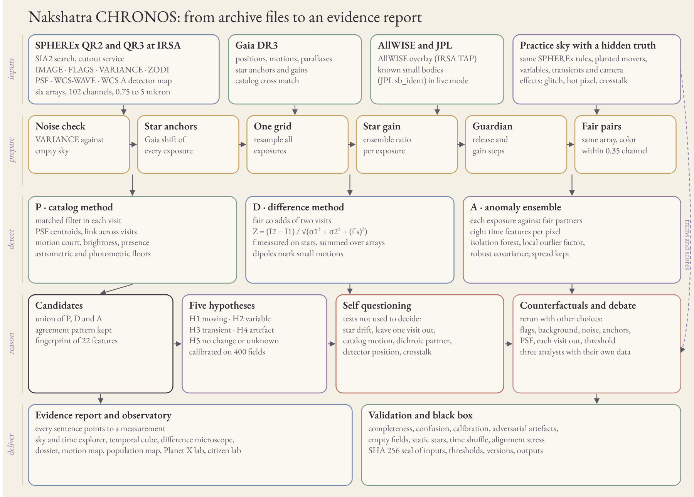

# Architecture

## Data flow

1. **Inputs.** Live mode searches IRSA SIA2 (collections spherex_qr3 and spherex_qr2) around a position, reads cutouts of every exposure with all extensions, asks Gaia DR3 for stars, AllWISE for an overlay and JPL for known small bodies. Practice mode renders a field that follows the SPHEREx rules and keeps the truth aside (`backend/sky.py`).
2. **Prepare** (`backend/core.py`, `backend/pipeline.py`). Noise check against empty sky, star anchors, resampling to one reference grid (north up, 6.15 arcsecond pixels), star ensemble gain per exposure, calibration guardian, fair pairs.
3. **Detect** (`backend/pipeline.py`). P catalog, D difference, A anomaly ensemble. Candidates are the union of their detections within 2.5 pixels, with the agreement pattern kept.
4. **Measure and reason** (`backend/pipeline.py`, `backend/engine.py`, `backend/investigate.py`). Fingerprint of 22 features, five hypothesis engine, self questioning tests, artefact court, counterfactual reanalysis on eleven variant states, debate, memory of the place, identity network, spectral fingerprint, oracle, evidence linked report.
5. **Deliver** (`backend/observatory.py`, `frontend/`). One JSON document per field holds every number and every image as bytes; the page renders it with canvas. The static site in `site/` holds the same documents for prepared fields.
6. **Record.** Inputs, thresholds, code hashes, versions and outputs are sealed with SHA 256. `POST /api/reproduce` reruns a practice investigation from its record and compares the output digest.

## Modules

| File | Role |
|---|---|
| `backend/core.py` | Exposure model, practice sky for one star, PSF photometry and centroids, anchors, noise check, motion court with parallax, fair pair score, false change meter, injection recovery |
| `backend/sky.py` | Practice observatory fields: sources, events, camera effects, truth |
| `backend/pipeline.py` | Registration, gains, co adds, the three detectors, candidates, measurements, fingerprints, truth matching |
| `backend/engine.py` | The frozen five hypothesis model and its unknown rule |
| `backend/investigate.py` | Challenges, robustness, debate, chain, graph, oracle, cutouts, spectral fingerprint, report, field products, record |
| `backend/connectors.py` | IRSA SIA2 and cutouts, MEF reading (flags from MP keywords, WCS-WAVE color, PSF zones, WCS A detector map), Gaia, AllWISE, JPL |
| `backend/observatory.py` | Field list, coordinate parser, investigation endpoint with cache, validation, reproduce, Planet X lab |
| `backend/app.py`, `backend/extras.py` | The story page endpoints (one star, five steps, English and Bangla) and the static file server |
| `frontend/` | `index.html`, `app.js`, `charts.js`, `style.css`, `story.html`, `extras.js`, fonts, `architecture.svg` |
| `scripts/` | `calibrate_engine.py`, `build_static.py`, `make_figures.py`, `make_architecture.py`, `build_deck.py`, `make_video.py`, `prefetch.py` |

## Endpoints

| Endpoint | Answer |
|---|---|
| `GET /api/fields` | Prepared targets and fields |
| `GET /api/resolve?q=` | RA and Dec from degrees, sexagesimal or a target name |
| `GET /api/investigate?key=&mode=sim|live&ra=&dec=&size=&fov=&deep=` | The whole investigation of one field |
| `GET /api/validation` | `data/validation.json` |
| `POST /api/reproduce` | Rerun from a record, compare digests |
| `GET /api/planetlab?d=&mass=&albedo=&temp=&limit=&lat=` | Planet X sandbox numbers with assumptions |
| `GET /api/load`, `/api/pair`, `/api/motion`, ... | The story page (see `backend/app.py`) |
