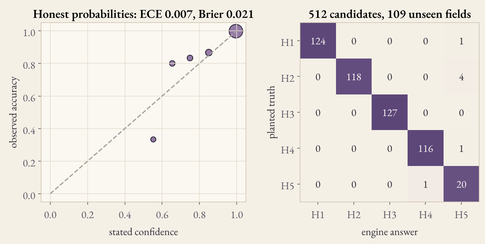
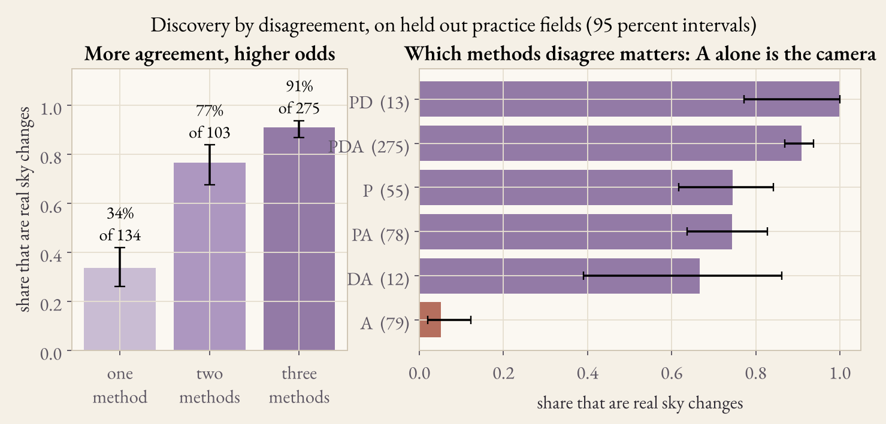
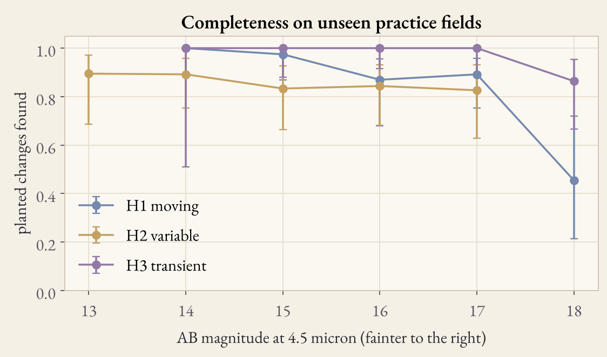

# Validation

Every number here comes from `data/validation.json`, written by `scripts/calibrate_engine.py`. Fields are split 70 percent for training and 30 percent for testing, by field. Intervals are 95 percent Wilson intervals. All numbers hold for the practice sky only.

| Measure | Value |
|---|---|
| Training fields and candidates | 251 and 1145 |
| Test fields and candidates | 109 and 512 |
| Accuracy when the engine decides | 98.8 percent |
| Share called unknown | 1.8 percent |
| Brier score | 0.021 |
| Expected calibration error | 0.007 |

## Per class on the test fields

| Class | Precision | Recall | Cases |
|---|---|---|---|
| H1 moving | 1.00 | 0.99 | 125 |
| H2 variable | 1.00 | 0.97 | 122 |
| H3 transient | 1.00 | 1.00 | 127 |
| H4 artefact | 0.99 | 0.99 | 117 |
| H5 no change | 0.77 | 0.95 | 21 |

## Discovery by disagreement

| Methods that flagged the candidate | Real sky changes |
|---|---|
| one | 34 percent of 134 (26 to 42) |
| two | 77 percent of 103 (68 to 84) |
| three | 91 percent of 275 (87 to 94) |
| A only | 5 percent of 79 |

## Adversarial camera effects

Called artefact or unknown, never a sky change: glitch 36 of 36, hot pixel 34 of 34, crosstalk copy 47 of 47.

## Completeness

## Negative controls

* 40 empty fields: 0.375 false candidates per field, at most 2.
* 840 catalog stars with no motion, far from every planted change: none called moving (interval 0 to 0.5 percent).
* Every practice investigation also runs a null twin (the same field with all planted changes removed), a time shuffle of every moving track, and an alignment stress count in the difference microscope.

## Whole sky tiles

scripts/make_sky_tiles.py, data/sky_tiles.json. 48 HEALPix tiles (nside 2), each with a science field, a null twin and an injection twin with six planted changes. Completeness and false alarms are pooled by kind of tile.

| Kind of tile | Tiles | Completeness (injection twins) | Raw / truth | Corrected / truth |
|---|---|---|---|---|
| normal | 26 | 92 percent | 97 percent | 104 percent |
| normal, crowded (galactic latitude under 20) | 14 | 89 percent | 98 percent | 110 percent |
| deep (six visits, ecliptic latitude over 60) | 4 | 50 percent | 45 percent | 91 percent |
| deep, crowded | 4 | 43 percent | 50 percent | 117 percent |
| all | 48 | | 90 percent | 106 percent |

The null twins gave no called sky change. Every tile agrees with its truth within two errors. The deep tiles show a real weakness: the engine was trained on four visit fields and says unknown more often with six visits. The correction removes the imprint from the map; retraining with deep fields would remove it from the engine.

## Injection into real QR3 files

scripts/inject_real.py on GitHub Actions (workflow real_injection), collection spherex_qr3, with the EPSF of each file. Five real fields, four trials each, six planted sources per trial.

| Field | Usable exposures | Visits | Arrays | Own candidates | Planted found |
|---|---|---|---|---|---|
| R Draconis | 65 | 2 | 1 to 6 | 0 | 0 of 24 |
| Deep field near the north ecliptic pole (270.0, +66.56) | 30 | 5 | 2, 5 | 11 | 10 of 24 |
| Deep field (262.0, +64.0) | 84 | 5 | 1 to 6 | 15 | 12 of 24 |
| Deep field near the south ecliptic pole (90.0, -66.56) | 32 | 5 | 2, 5 | 0 | 4 of 24 |
| Deep field (98.0, -64.0) | 53 | 5 | 1, 2, 4, 5 | 1 | 3 of 24 |

All: 29 of 120 (24 percent, Wilson interval 17 to 33 percent). By brightness: AB 14, 13 of 28; AB 15, 6 of 22; AB 16, 6 of 31; AB 17, 4 of 26; AB 18, 0 of 13. The engine trained on the practice sky said unknown for every real candidate, planted or not, because their fingerprints lie outside its training set. Retrained with 540 practice rows and the real rows, and scored on each field held out in turn, it decides 17 of 29 planted candidates and is right in 12 (71 percent, 47 to 87 percent). A first run with a Gaussian PSF in place of the EPSF found 35 of 120.

## Real archive check

One real IRSA SIA2 answer (collection spherex_qr3, Barnard's Star) was read through a web reader. The columns that CHRONOS uses are present, the array number is in each file name, and the two arrays behind the dichroic (3 and 6, 2 and 5) share one obs_id and one start time. This is the pairing that the practice sky and the partner array test assume. The full live path was not run against the archive; see [LIMITS.md](LIMITS.md).

## What this does not show

